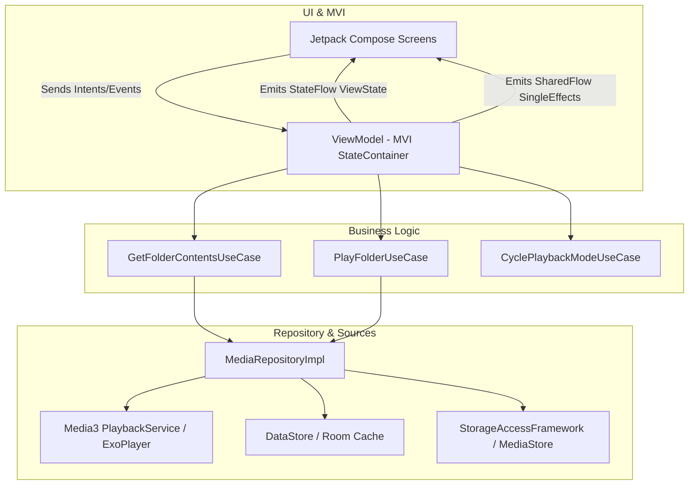
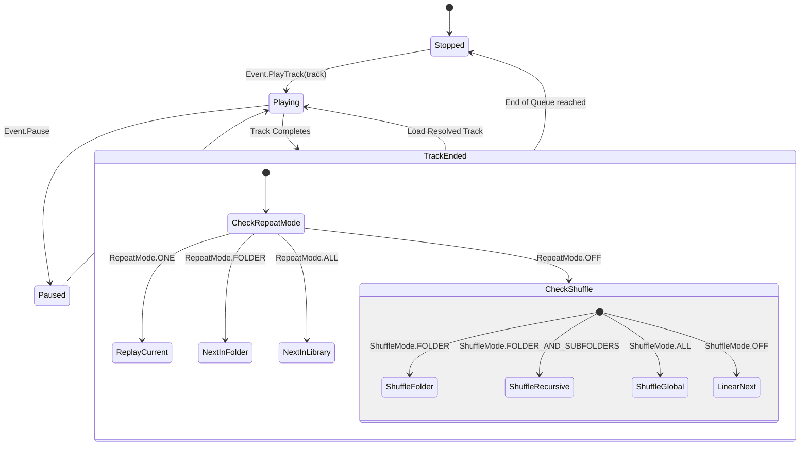

# Comprehensive Architecture Blueprint & Implementation Plan
## Modern Android Folder-Based Music Player ("CarFolderPlayer")

---

## 1. Executive Summary & Core Philosophy

### Core Purpose
**CarFolderPlayer** is a modern, ad-free, folder-first audio playback application designed specifically for automotive use cases. Unlike standard media players that aggregate tracks via ID3 metadata into forced "Artist/Album/Genre" taxonomies, this application strictly respects the user's physical directory structure on local storage (Internal or SD Card) or SAF (Storage Access Framework) directory trees.

### Core Distinctions & Anti-Features
* **Anti-Feature: No Metadata Aggregation:** Tracks are presented strictly in filesystem order (alphabetical/numerical by filename).
* **Car-Optimized UI/UX:** Large touch targets (minimum 64dp x 64dp), high-contrast typography, high-affordability controls, minimal nested navigation, and full Bluetooth AVRCP/Media3 MediaSession support for steering wheel controls.
* **Full Granular Playback Modes:**
  * **Repeat:** `OFF` | `ONE` | `FOLDER` | `ALL`
  * **Shuffle/Random:** `OFF` | `FOLDER` | `FOLDER_AND_SUBFOLDERS` | `ALL`

### Modern Tech Stack (2024-2026 Android Standards)
* **Language & Concurrency:** Kotlin 2.x, Coroutines (`Dispatchers.IO`, `Dispatchers.Main`), Kotlin `StateFlow` and `SharedFlow`.
* **Architecture:** Clean Architecture + Unidirectional Data Flow / Model-View-Intent (MVI).
* **UI:** Jetpack Compose (Material3), Compose Navigation (`Navigation 2.8+` with type-safe routing).
* **Audio Core:** **Jetpack Media3 (ExoPlayer + MediaSessionService)** for robust background playback, lock screen controls, and Bluetooth AVRCP integration.
* **Persistence & DI:** Room Database (for playback history, bookmarks, and index caching), DataStore (for user preferences), Hilt (Dependency Injection).

---

## 2. Architecture & Layering Strategy

We follow Google's official **Guide to App Architecture**, separating code into **Data**, **Domain**, and **Presentation** layers with strict dependency flow (Presentation → Domain ← Data).



### Layer Responsibilities

1. **Domain Layer (Pure Kotlin - No Android Dependencies):**
   * Contains Domain Models (`AudioTrack`, `FolderNode`, `PlaybackState`, `RepeatMode`, `ShuffleMode`).
   * Contains UseCases (`PlayTrackUseCase`, `ToggleShuffleUseCase`, `NavigateDirectoryUseCase`).
   * Defines Repository Interfaces (`MediaRepository`, `PreferencesRepository`).

2. **Data Layer:**
   * Implements Repositories (`MediaRepositoryImpl`, `PreferencesRepositoryImpl`).
   * Contains Data Sources:
     * `StorageDataSource`: Reads file trees via DocumentFile / ContentResolver.
     * `Media3Service`: Manages `ExoPlayer` instance, `MediaSession`, and audio focus.
     * `PreferencesDataSource`: Uses Jetpack DataStore for saving current folder, track position, repeat/shuffle states.

3. **Presentation Layer (Compose + MVI):**
   * Views subscribe to immutable `StateFlow<ViewState>`.
   * User interaction produces discrete sealed `Event` objects dispatched to `ViewModel`.
   * One-time side effects (e.g., Toast, Permission Request) pass via `SharedFlow<Effect>`.

---

## 3. Playback State Machine (Repeat & Shuffle Logic)

The core playback manager calculates the *next track queue* dynamically based on two independent enum configurations.



### Enum Definitions
```kotlin
enum class RepeatMode {
    NONE,   // Stop at end of current folder/queue
    ONE,    // Loop current track endlessly
    FOLDER, // Loop current folder tracks endlessly
    ALL     // Loop entire root directory endlessly
}

enum class ShuffleMode {
    OFF,                   // Sequential by filename
    FOLDER,                // Randomize tracks within current folder only
    FOLDER_AND_SUBFOLDERS, // Randomize tracks in current folder + all recursive children
    ALL                    // Randomize all tracks across root storage
}
```

---

## 4. Class & Data Contract Specifications

### 4.1 Domain Models & Enums

```kotlin
// Domain Model: AudioTrack
data class AudioTrack(
    val id: String, // URI string or File path
    val title: String, // Filename without extension
    val path: String,
    val parentFolderPath: String,
    val durationMs: Long,
    val trackNumber: Int? = null // Extracted from "01 - Track.mp3" if present
)

// Domain Model: FolderNode
data class FolderNode(
    val name: String,
    val path: String,
    val parentPath: String?,
    val subFolders: List<FolderNode> = emptyList(),
    val audioTracks: List<AudioTrack> = emptyList()
)
```

### 4.2 Presentation Layer MVI Contracts (Player Screen)

```kotlin
// ViewState for Player Screen
data class PlayerViewState(
    val currentTrack: AudioTrack? = null,
    val isPlaying: Boolean = false,
    val currentPositionMs: Long = 0L,
    val totalDurationMs: Long = 0L,
    val currentFolderTitle: String = "No Folder Selected",
    val repeatMode: RepeatMode = RepeatMode.NONE,
    val shuffleMode: ShuffleMode = ShuffleMode.OFF,
    val isLoading: Boolean = false,
    val errorMessage: String? = null
)

// Intents/Events emitted by UI
sealed interface PlayerUiEvent {
    data object PlayPauseToggled : PlayerUiEvent
    data object SkipNextClicked : PlayerUiEvent
    data object SkipPreviousClicked : PlayerUiEvent
    data class SeekTo(val positionMs: Long) : PlayerUiEvent
    data object CycleRepeatMode : PlayerUiEvent
    data object CycleShuffleMode : PlayerUiEvent
    data class PlayFolder(val folderPath: String, val startTrackIndex: Int = 0) : PlayerUiEvent
}

// Single side effects (Toasts, Navigation)
sealed interface PlayerUiEffect {
    data class ShowToast(val message: String) : PlayerUiEffect
    data class NavigateToFolderBrowser(val currentPath: String) : PlayerUiEffect
}
```

---

## 5. Directory Structure & Package Hierarchy

```text
com.carfolderplayer.app/
├── CarFolderPlayerApplication.kt
├── di/
│   ├── AppModule.kt             // Hilt bindings for Repositories & Coroutines
│   ├── MediaModule.kt           // Hilt bindings for Media3 / ExoPlayer
│   └── DatabaseModule.kt        // Room & DataStore bindings
├── data/
│   ├── local/
│   │   ├── preferences/         // DataStore manager
│   │   ├── db/                  // Room DAO & Database definition
│   │   └── storage/             // SAF / DocumentFile scanner
│   ├── repository/
│   │   ├── MediaRepositoryImpl.kt
│   │   └── PreferencesRepositoryImpl.kt
│   └── service/
│       └── PlaybackService.kt   // Media3 MediaSessionService
├── domain/
│   ├── model/                   // AudioTrack, FolderNode, RepeatMode, etc.
│   ├── repository/              // Repository Interfaces
│   └── usecase/
│       ├── GetFolderContentsUseCase.kt
│       ├── PlayTrackUseCase.kt
│       ├── ResolveNextTrackUseCase.kt
│       └── ToggleRepeatShuffleUseCase.kt
└── presentation/
    ├── main/                    // MainActivity & Navigation Root
    ├── player/                  // Player Screen (MVI)
    │   ├── PlayerScreen.kt
    │   ├── PlayerViewModel.kt
    │   └── components/          // Big Car Controls, Progress Bar
    ├── browser/                 // Folder/File Browser Screen
    │   ├── FolderBrowserScreen.kt
    │   └── FolderBrowserViewModel.kt
    └── theme/                   // High-Contrast Material3 Theme
```

---

## 6. Implementation Strategy & Step-by-Step Milestones

### Milestone 1: Project Initialization & Dependency Graph
1. Create New Project in Android Studio: Select **Empty Activity (Compose)**.
2. Configure Version Catalog (`gradle/libs.versions.toml`):
   * Add `androidx.media3:media3-exoplayer:1.4.+`
   * Add `androidx.media3:media3-session:1.4.+`
   * Add `androidx.navigation:navigation-compose:2.8.+`
   * Add `com.google.dagger:hilt-android:2.51+`
   * Add `androidx.datastore:datastore-preferences:1.1.+`
   * Add `androidx.room:room-ktx:2.6.+`

### Milestone 2: SAF Storage Access & Folder Scanning
1. Implement `StorageAccessFramework` launcher using `ActivityResultContracts.OpenDocumentTree()`.
2. Create `StorageDataSource` using `DocumentFile` or low-level `ContentResolver` queries to recursively parse audio files strictly preserving natural sort order (e.g., using `String.CASE_INSENSITIVE_ORDER` or natural alphanumeric sort).
3. Build `GetFolderContentsUseCase` returning a `FolderNode` populated with `AudioTrack` items.

### Milestone 3: Background Audio Engine (Jetpack Media3)
1. Create `PlaybackService` extending `MediaSessionService`.
2. Initialize `ExoPlayer` inside `PlaybackService`. Configure `AudioAttributes` for Automotive (`AUDIO_USAGE_MEDIA`, `CONTENT_TYPE_MUSIC`).
3. Handle Audio Focus seamlessly (pause on incoming call/navigation prompt).
4. Connect `MediaSession` to surface notification controls and Bluetooth AVRCP meta-data.

### Milestone 4: Domain Logic & Custom Repeat/Shuffle State Engine
1. Implement `ResolveNextTrackUseCase`:
   * Given `currentFolder`, `currentTrack`, `RepeatMode`, and `ShuffleMode`, calculate the deterministic or random next `AudioTrack`.
2. Persist `currentTrackId`, `currentPositionMs`, `repeatMode`, and `shuffleMode` into DataStore on state changes.

### Milestone 5: Car-Centric MVI Presentation Layer
1. Build `PlayerViewModel`:
   * Expose `val viewState: StateFlow<PlayerViewState>`.
   * Bind `MediaController` to observe real-time playback updates from `PlaybackService`.
2. Construct `PlayerScreen` in Jetpack Compose:
   * **UI Constraints:** All primary action buttons (`Play/Pause`, `Next`, `Previous`, `Repeat Mode`, `Shuffle Mode`) set to a minimum height/width of `64.dp`.
   * **Typography:** Use large font scale (`MaterialTheme.typography.headlineMedium` for track titles, `titleLarge` for folder paths).
   * **Folder Browser Screen:** Virtualized `LazyColumn` with large tap area per item (minimum list item height `72.dp`).

---

## 7. Educational Deep-Dives & Key Android Principles

### Why Jetpack Media3 instead of Legacy MediaPlayer?
Legacy `android.media.MediaPlayer` is error-prone, lacks native background lifecycle handling, and requires manual wiring for lock screen/Bluetooth metadata. Jetpack Media3 unifies `ExoPlayer` (rendering engine) and `MediaSession` (system architecture interface) into a single standard library, guaranteeing compliance with modern background execution limits and Android Auto / Bluetooth AVRCP protocols.
* **Reference:** [Android Developers - Media3 Documentation](https://developer.android.com/guide/topics/media/media3)

### Storage Access Framework (SAF) vs. MediaStore
Standard music apps query `MediaStore.Audio.Media.EXTERNAL_CONTENT_URI`. MediaStore automatically indexes files and extracts ID3 tags, flattening the filesystem into virtual Artist/Album buckets. Because our core feature is folder hierarchy preservation, we utilize SAF (`Intent.ACTION_OPEN_DOCUMENT_TREE`) to obtain persistent URI permissions to a user-selected music root folder.
* **Reference:** [Android Developers - Scoped Storage & SAF](https://developer.android.com/training/data-storage/shared/documents-files)

### Type-Safe Jetpack Compose Navigation
Using Compose Navigation 2.8+, routes are defined using Kotlin `@Serializable` objects or classes instead of prone-to-error String paths:
```kotlin
@Serializable
object PlayerRoute

@Serializable
data class FolderBrowserRoute(val initialFolderPath: String?)
```
* **Reference:** [Type Safe Navigation in Compose](https://developer.android.com/guide/navigation/design/type-safety)