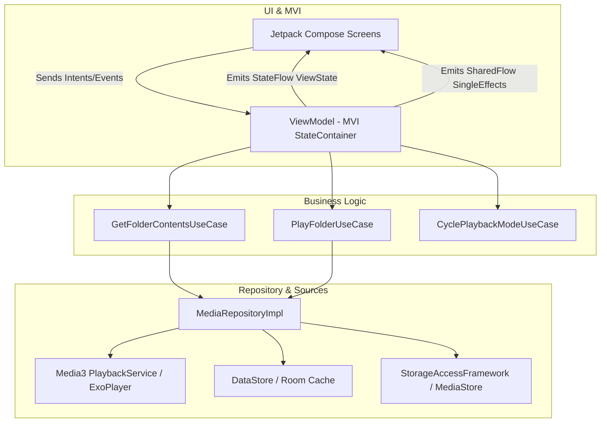
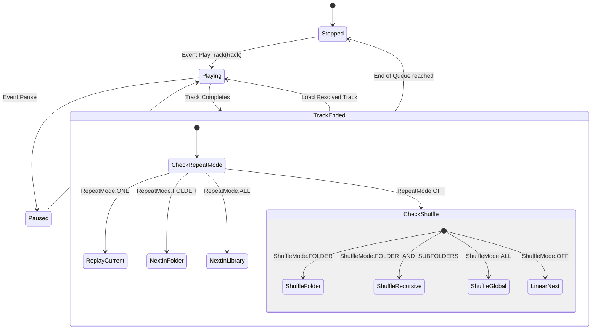

## Modern Android Folder-Based Music Player ("CarFolderPlayer")

---

## 1. Executive Summary & Core Philosophy

### Core Purpose
**CarFolderPlayer** is a modern, ad-free, folder-first audio playback application designed specifically for automotive use cases. Unlike standard media players that aggregate tracks via ID3 metadata into forced "Artist/Album/Genre" taxonomies, this application strictly respects the user's physical directory structure on local storage (Internal or SD Card) or SAF (Storage Access Framework) directory trees.

### Core Distinctions & Anti-Features
* **Anti-Feature: No Metadata Aggregation:** Tracks are presented strictly in filesystem order (alphabetical/numerical by filename).
* **Car-Optimized UI/UX:** Large touch targets (minimum 64dp x 64dp), high-contrast typography, high-affordability controls, minimal nested navigation, and full Bluetooth AVRCP/Media3 MediaSession support for steering wheel controls.
* **Full Granular Playback Modes:**
  * **Repeat:** `OFF` | `ONE` | `FOLDER` | `ALL`
  * **Shuffle/Random:** `OFF` | `FOLDER` | `FOLDER_AND_SUBFOLDERS` | `ALL`

### Modern Tech Stack (2024-2026 Android Standards)
* **Language & Concurrency:** Kotlin 2.x, Coroutines (`Dispatchers.IO`, `Dispatchers.Main`), Kotlin `StateFlow` and `SharedFlow`.
* **Architecture:** Clean Architecture + Unidirectional Data Flow / Model-View-Intent (MVI).
* **UI:** Jetpack Compose (Material3), Compose Navigation (`Navigation 2.8+` with type-safe routing).
* **Audio Core:** **Jetpack Media3 (ExoPlayer + MediaSessionService)** for robust background playback, lock screen controls, and Bluetooth AVRCP integration.
* **Persistence & DI:** Room Database (for playback history, bookmarks, and index caching), DataStore (for user preferences), Hilt (Dependency Injection).

---

## 2. Architecture & Layering Strategy

We follow Google's official **Guide to App Architecture**, separating code into **Data**, **Domain**, and **Presentation** layers with strict dependency flow (Presentation → Domain ← Data).

### Layer Responsibilities

1. **Domain Layer (Pure Kotlin - No Android Dependencies):**
   * Contains Domain Models (`AudioTrack`, `FolderNode`, `PlaybackState`, `RepeatMode`, `ShuffleMode`).
   * Contains UseCases (`PlayTrackUseCase`, `ToggleShuffleUseCase`, `NavigateDirectoryUseCase`).
   * Defines Repository Interfaces (`MediaRepository`, `PreferencesRepository`).

2. **Data Layer:**
   * Implements Repositories (`MediaRepositoryImpl`, `PreferencesRepositoryImpl`).
   * Contains Data Sources:
     * `StorageDataSource`: Reads file trees via DocumentFile / ContentResolver.
     * `Media3Service`: Manages `ExoPlayer` instance, `MediaSession`, and audio focus.
     * `PreferencesDataSource`: Uses Jetpack DataStore for saving current folder, track position, repeat/shuffle states.

3. **Presentation Layer (Compose + MVI):**
   * Views subscribe to immutable `StateFlow<ViewState>`.
   * User interaction produces discrete sealed `Event` objects dispatched to `ViewModel`.
   * One-time side effects (e.g., Toast, Permission Request) pass via `SharedFlow<Effect>`.

---

## 3. Playback State Machine (Repeat & Shuffle Logic)

The core playback manager calculates the *next track queue* dynamically based on two independent enum configurations.

